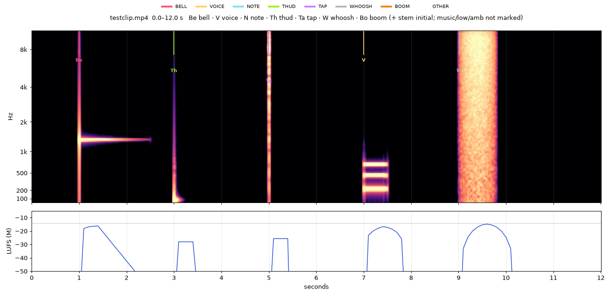
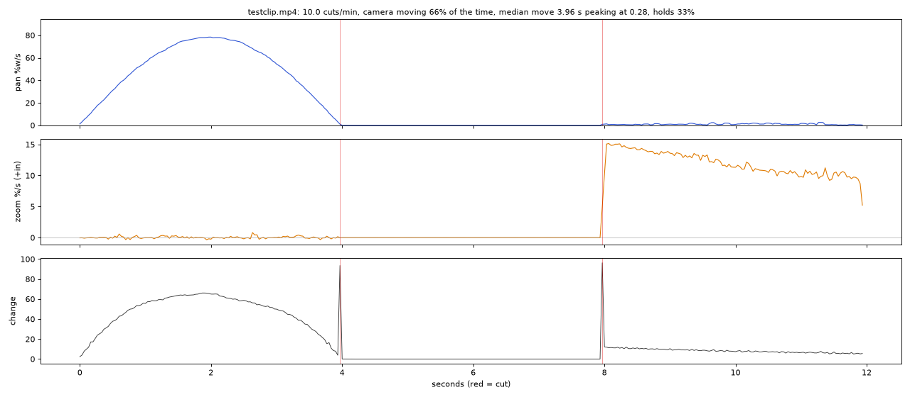
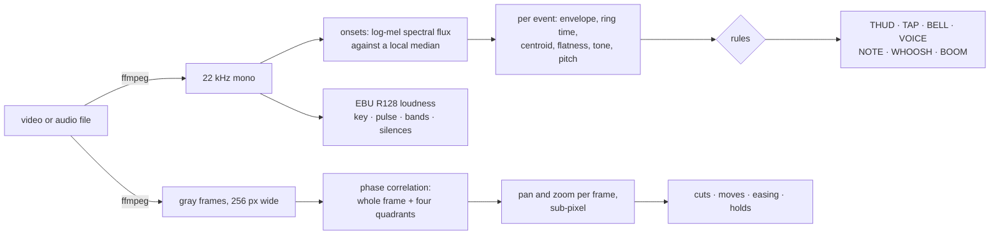

<div align="center">

# film-ear-eye

**A Claude skill that lets an agent hear a mix and see a camera move.**

Two small Python tools turn any video into numbers and pictures an AI agent (or you) can read:
what every sound is, when it lands, how loud the mix is, how the camera moves and how each move eases.


</div>

---

## Why

An agent that edits video is working blind and deaf. It will tell you the pacing "feels right" and the mix
"sounds balanced" without having heard or seen anything. This skill replaces that with measurement:

| it says | this skill makes it check |
|---|---|
| "the camera eases nicely" | where in each move the speed peaks, and mean/peak speed |
| "the pacing matches the reference" | cuts per minute, shot length, hold share, side by side with the reference |
| "a soft click on each tap" | whether that click is classed TAP, or BELL (it rings), or VOICE (it hums) |
| "levels are fine" | integrated LUFS, loudness range, true peak, every silence over half a second |

## What you get

<table>
<tr>
<td width="50%"><b>ear.py</b>: every event marked on a spectrogram, loudness underneath</td>
<td width="50%"><b>eye.py</b>: pan speed, zoom speed and change over time, cuts in red</td>
</tr>
<tr>
<td></td>
<td></td>
</tr>
</table>

Both pictures come from the 12-second test film this repo builds for itself (see [Self-test](#self-test)).
The pan is the bell-shaped curve on the left: it eases in, peaks halfway, eases out. The zoom starts at
15 % a second and slows as the picture grows. The straight flat line in the middle is a hold.

**The event table `ear.py` writes for that film:**

| t | class | why | heard as (`--tags`) | peak dB | ring ms |
|---|---|---|---|---|---|
| 1.00 | BELL | rings 690 ms on a clear tone near 1319 Hz (E6) | Ding 0.40, Beep, bleep 0.28 | -11.0 | 690 |
| 3.00 | THUD | short and low: centroid 74 Hz, 68 ms, no ring | Sound effect 0.10, Music 0.09 | -9.1 | 68 |
| 5.00 | TAP | short and bright: centroid 6186 Hz, 5 ms | Speech 0.03, Sound effect 0.03 | -14.0 | 5 |
| 7.00 | VOICE | pitched 220.5 Hz (A3), 395 ms, voice-like range | Sine wave 0.40, Chirp tone 0.36 | -15.1 | 395 |
| 9.01 | WHOOSH | noise for 695 ms, centroid 5271 Hz | Static 0.45, White noise 0.05 | -27.8 | 695 |

**The move list `eye.py` writes for it:**

```json
{"cuts_s": [3.97, 7.97],
 "moves": [{"t": 0.03, "dur": 3.93, "peak": 78.4, "t_peak": 0.5,  "smooth": 0.65, "jerk": 3.9},
           {"t": 7.97, "dur": 4.0,  "peak": 7.6,  "t_peak": 0.05, "smooth": 0.78, "jerk": 28.7}]}
```

## Install

```bash
# as a Claude Code skill (personal)
git clone https://github.com/DevCrazyCube/claude-skill-film-ear-eye ~/.claude/skills/film-ear-eye

# or for one project
git clone https://github.com/DevCrazyCube/claude-skill-film-ear-eye .claude/skills/film-ear-eye

pip install -r ~/.claude/skills/film-ear-eye/requirements.txt   # numpy, matplotlib
ffmpeg -version                                                  # must be on your PATH
```

Claude picks the skill up on its own when you ask it to judge, compare or finish a video. You can also run
the tools by hand; they are plain scripts.

## Use

```bash
# how does my cut move, next to two films I like?
python3 scripts/eye.py refs/a.mp4 refs/b.mp4 out/mine.mp4 --out report/eye

# what is in my mix?
python3 scripts/ear.py out/mine.mp4 --out report/ear

# the same, plus each stem on its own (every *.wav in the folder)
python3 scripts/ear.py out/mine.mp4 --stems stems/ --out report/ear

# only a part of a long film, 10 s per picture
python3 scripts/ear.py film.mp4 --from 30 --to 60 --win 10 --out report/ear

# class sound effects before they go in the mix
python3 scripts/ear.py --samples sfx/click.wav sfx/pop.wav
```

| output | what it is |
|---|---|
| `report/eye/eye.md` | one row per film: cuts, camera share, speeds, easing, holds, rhythm, with a legend |
| `report/eye/<film>-motion.png` | pan, zoom and change over time, cuts marked |
| `report/eye/<film>-sheet.png` | contact sheet, one frame per second |
| `report/eye/<film>-moves.json` | every cut and every camera move with its numbers |
| `report/ear/ear.md` | loudness, key, pulse, bands, silences, the event table |
| `report/ear/ear-NN-*.png` | a labelled spectrogram per window |
| `report/ear/events.json` | every event with all measured values |

## How it works



<details>
<summary><b>ear.py in detail</b></summary>

- Audio is decoded to 22.05 kHz mono. A centred STFT (2048 / 256) feeds a log-mel spectral flux; an onset is a
  flux peak above the local median plus six median deviations, at least 60 ms after the last one.
- Each onset is described from the signal itself: a 5 ms RMS envelope gives the true start (where the level comes
  within 20 dB of its peak), the attack level and the ring time (how long it stays within 30 dB). The spectrum
  gives the centroid, the flatness (noise or tone), how far a tonal peak stands out at the head and in the tail,
  and the share of energy under 150 Hz. Pitch comes from YIN.
- A sound that *stops* also changes the spectrum. If the 50 ms before an onset were louder than anything after it,
  it is the tail of the previous sound and is dropped. The same goes for a sound that simply carries on: the same
  coarse spectrum after as before, at a comparable level, with no step up of 3 dB between one 20 ms and the next.
  So the fade of a tone or the middle of a swell is not counted, whatever else is in the file.
- A short rule list gives the class, and writes down why: a tail with a clear tone that rings = BELL; pitched in
  the voice range for long enough = VOICE; short and low = THUD; short and bright = TAP; a stretch of noise =
  WHOOSH; and so on.
- Loudness is ffmpeg's `ebur128` (integrated, range, true peak, momentary every 100 ms). The key guess correlates
  the chroma with the Krumhansl profiles; the pulse is the autocorrelation of the flux.

</details>

<details>
<summary><b>eye.py in detail</b></summary>

- Frames are read small and gray. For each pair, phase correlation (whitened, windowed) gives the shift of the
  whole picture and of each quadrant.
- Between two pixels the peak of a whitened correlation is a sinc, not a parabola (Foroosh et al., 2002). Using
  the sinc estimate measures the planted zoom within 2 %; the usual parabola read it 20 % slow.
- Pan is the whole-frame shift. Zoom is how far the quadrants move apart (+ = in). A cut is a spike in change
  with a weak correlation peak.
- A move is a stretch of 0.25 s or more above 2 % of the width a second. For each: top speed, where the top sits
  (`t_peak`), mean/peak speed (`smooth`) and the jitter of the curve (`jerk`). A cosine ease gives `t_peak` 0.5
  and `smooth` 2/π ≈ 0.64; a linear move gives `smooth` near 1.

</details>

## Self-test

The tools are checked against a film whose content is known, because everything in it is generated:

```bash
python3 tests/selftest.py
```

```
ear.py
  ok   classes in order: ['BELL', 'THUD', 'TAP', 'VOICE', 'WHOOSH']
  ok   BELL starts at (s): 1.0 (planted 1.0, tolerance 0.03)
  ...
eye.py
  ok   pan top speed (% of width a second): 78.4 (planted 78.5, tolerance 2.0)
  ok   pan peaks at (share of the move): 0.5 (planted 0.5, tolerance 0.05)
  ok   pan mean/peak speed: 0.65 (planted 0.64, tolerance 0.04)
  ok   zoom top speed (% a second): 15.2 (planted 15.0, tolerance 1.5)
  ...
all checks pass
```

`examples/make_test_clip.sh OUT.mp4` builds the film on its own: a cosine-eased pan, a cut, a hold, a cut and a
zoom, with a bell, a thud, a tap, a voice-like tone and a whoosh on silence.

## Optional extras

<details>
<summary><b><code>--words</code>: what a speech model hears</b></summary>

Catches mumbled lines and voice-like sounds a listener would take for words. Needs `faster-whisper` and
`soundfile`. A segment with a high no-speech score is marked "(probably not speech)": a speech model always
writes something.

```bash
pip install faster-whisper soundfile
EAR_LANG=nl python3 scripts/ear.py film.mp4 --words --out report/ear
```

</details>

<details>
<summary><b><code>--tags</code>: what a trained listener calls each sound</b></summary>

Adds a "heard as" column in AudioSet's 527 labels ("Ding", "Knock", "Static") and a label line for every 2 s.
Uses MIT's Audio Spectrogram Transformer as ONNX, locally (about 90 MB).

```bash
pip install onnxruntime
mkdir -p ~/.cache/ear-models/ast && cd ~/.cache/ear-models/ast
curl -LO https://huggingface.co/Xenova/ast-finetuned-audioset-10-10-0.4593/resolve/main/config.json
curl -L -o model_quantized.onnx https://huggingface.co/Xenova/ast-finetuned-audioset-10-10-0.4593/resolve/main/onnx/model_quantized.onnx
python3 scripts/ear.py film.mp4 --tags --out report/ear
```

`EAR_MODEL_DIR` points at another folder. The model has its own licence; read it on its model page.

</details>

If those packages live in another Python (a venv), set `EAR_PYTHON=/path/to/venv/bin/python`; the main tools keep
running in yours.

## Limits

- An event's "peak dB" is its level in the first 150 ms. A sound that swells, like the whoosh above, reads low.
- Classes say what a sound will be *taken for*, not whether it is good.
- Motion is measured from the whole picture: a large object crossing a still frame reads as a small pan, and
  flat or striped pictures give weak estimates.
- Neither tool sees design, acting or whether a joke lands. Good numbers are necessary, never sufficient.

## Repo layout

```
SKILL.md                    what Claude reads: when to run the tools and how to read them
scripts/ear.py              sound
scripts/eye.py              motion
scripts/ear_tags.py         the optional trained listener
examples/make_test_clip.sh  builds the 12 s test film
tests/selftest.py           17 checks against what was planted
docs/                       the two sample pictures above
```

## License

MIT
